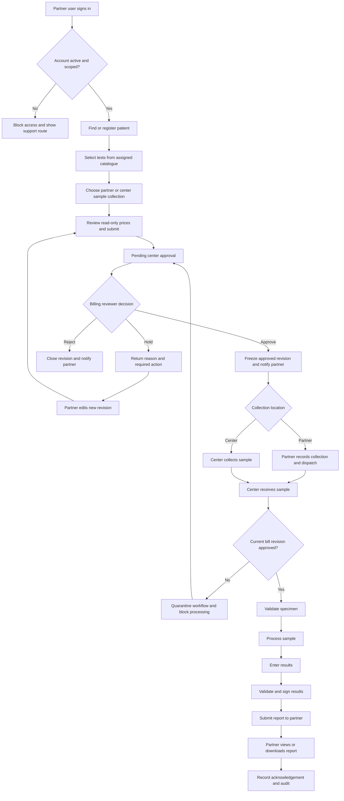
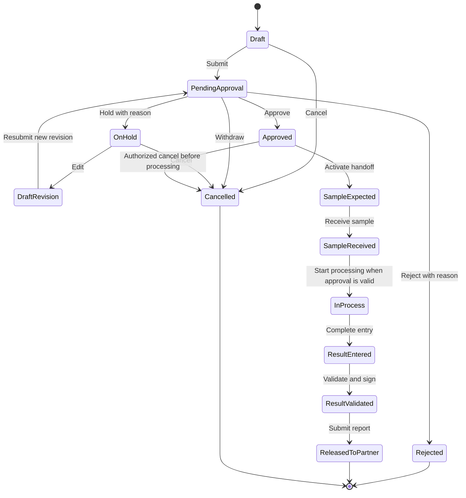
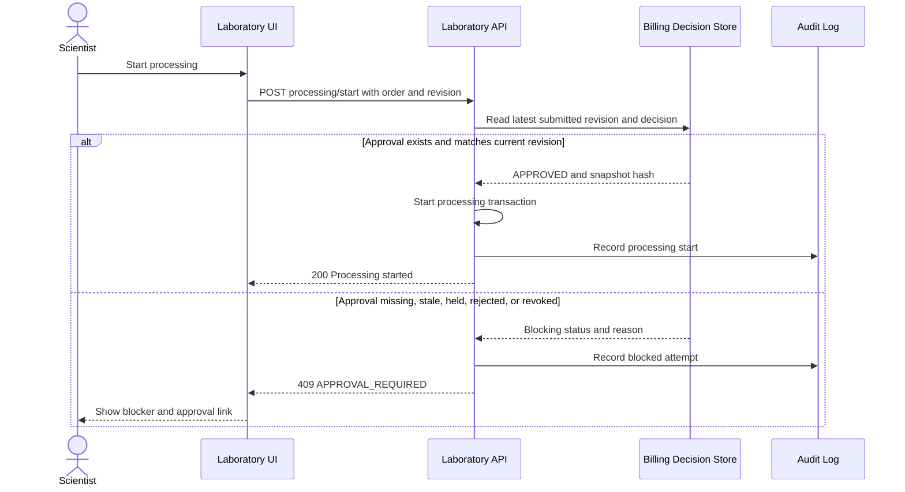
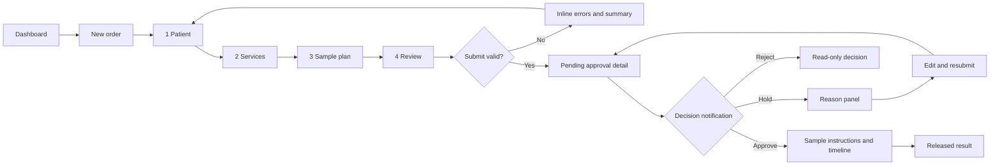
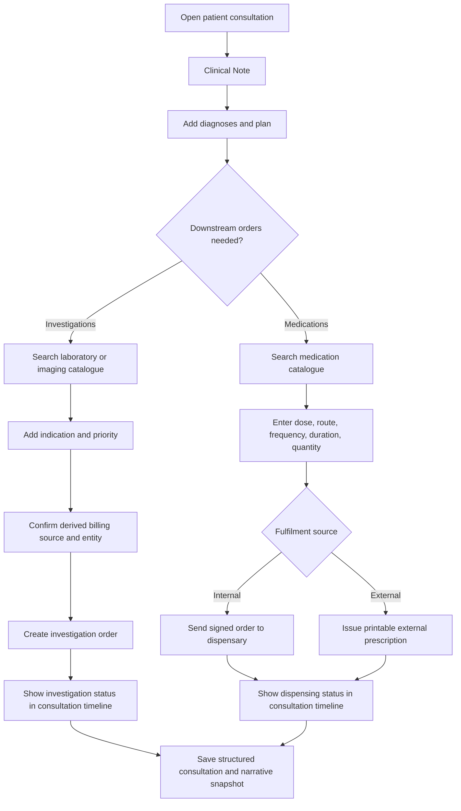
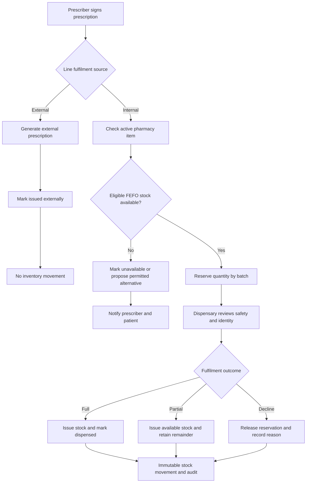
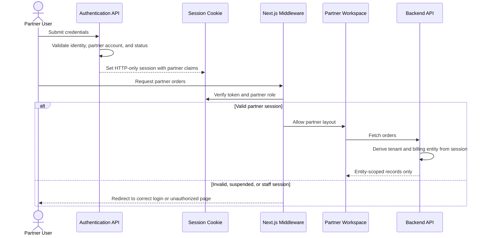

# Partner Billing and Pharmacy Flow Maps

These diagrams define the intended business flow. Status changes are backend-enforced commands; screens are views of those states.

## 1. End-to-End Partner Laboratory Flow

## 2. Billing State Machine

## 3. Approval Guard

## 4. Partner Order Screen Flow

## 5. Structured Consultation Flow

## 6. Internal and External Pharmacy Flow

## 7. Partner Authentication and Authorization

## 8. Responsibility Handoffs

| Stage | Responsible role | Exit condition |
| --- | --- | --- |
| Draft order | Partner billing officer / clinician | Patient, services, sample plan, and declaration complete |
| Financial review | Center billing reviewer | Approved, held with reason, or rejected with reason |
| Sample collection | Partner collector or center phlebotomist | Collection identity and time recorded |
| Sample receipt | Center receiving officer | Condition and chain of custody recorded |
| Processing | Scientist | Approved revision verified and testing completed |
| Result authorization | Validator / signatory | Result validated and signed |
| Result release | Authorized center user | Signed report explicitly submitted to partner |
| Medication fulfilment | External patient route or dispensary | Prescription issued or internal stock movement posted |

## 9. Exception Paths

| Exception | Required behavior |
| --- | --- |
| Price changes during draft | Refresh draft and show changed lines before submission |
| Price changes after submission | Preserve snapshot; reviewer sees mismatch warning |
| Partner edits a held order | Create new revision; previous decision remains immutable |
| Sample arrives before approval | Record receipt only if policy permits; quarantine and block processing |
| Sample rejected | Record reason, notify partner, and request recollection without silently changing billing |
| Report corrected after release | Create signed replacement version and notify partner |
| Insufficient internal stock | Allow partial fulfilment or external reroute according to policy |
| Prescription cancelled after reservation | Release reservation; do not post an issue movement |
| Concurrent stock issue | One transaction succeeds; stale request receives conflict and refreshes availability |